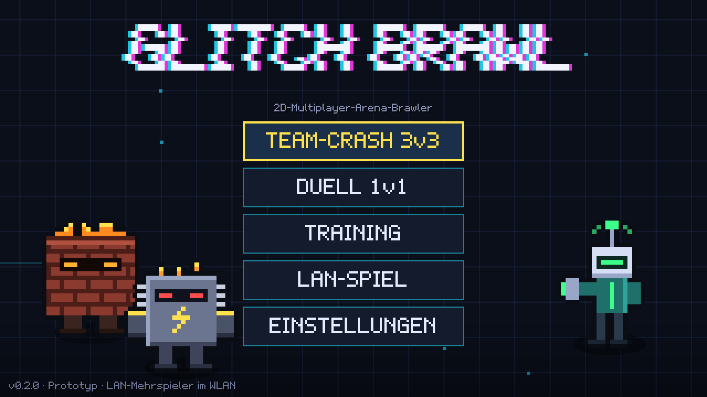
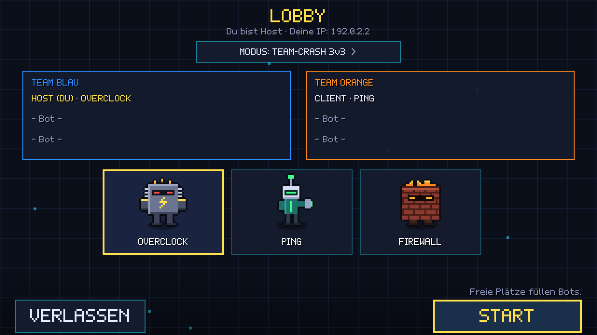
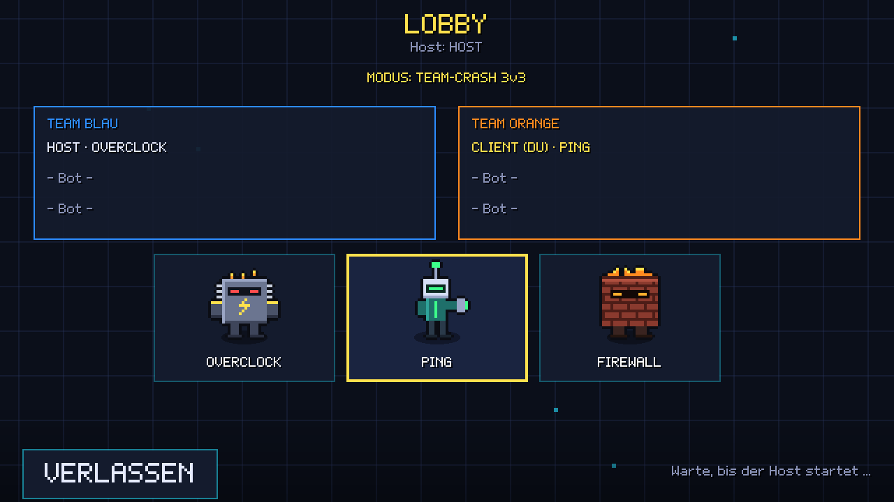
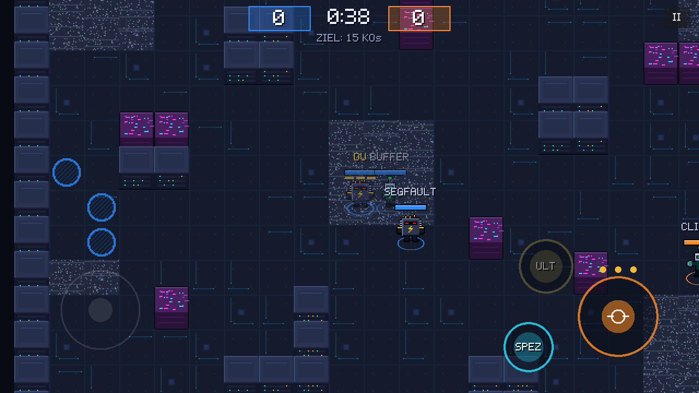
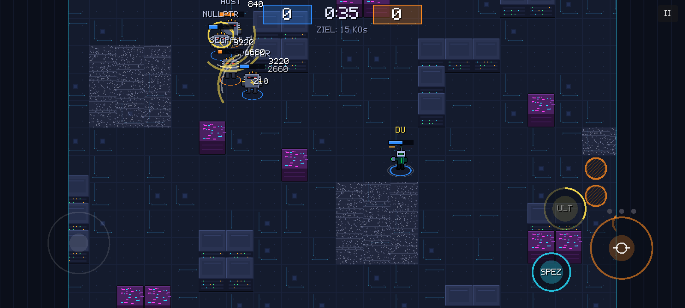
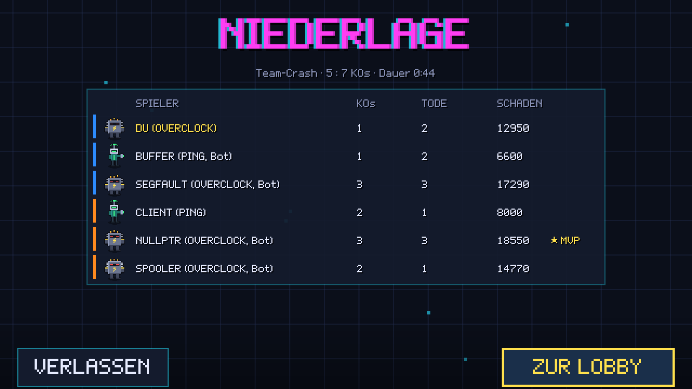
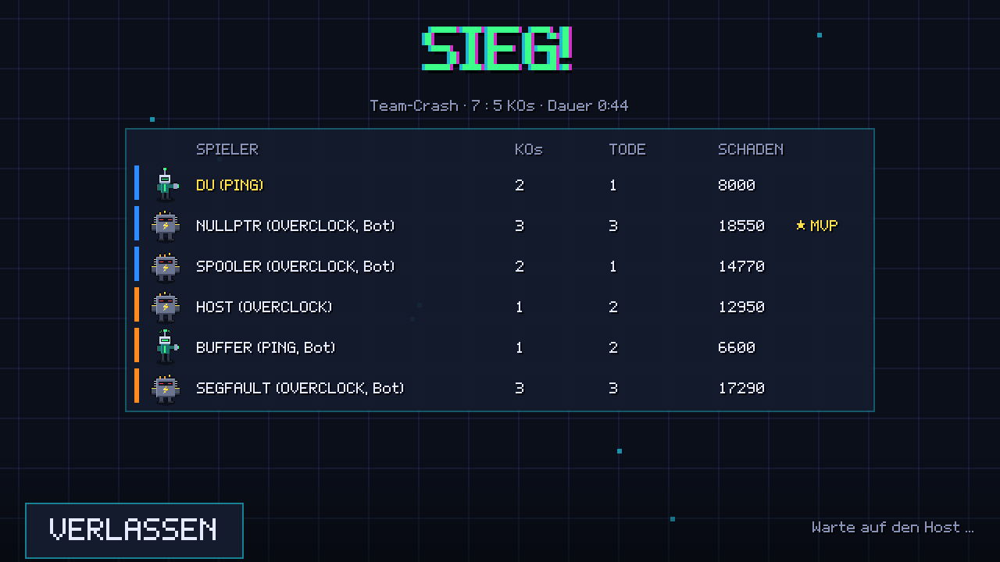
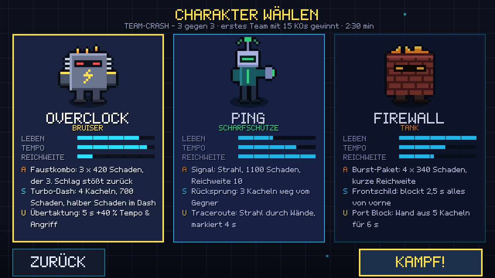
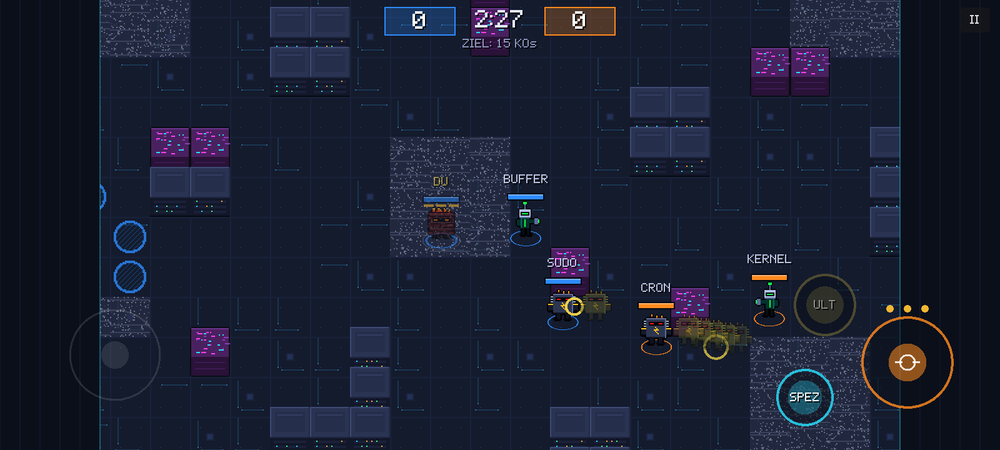
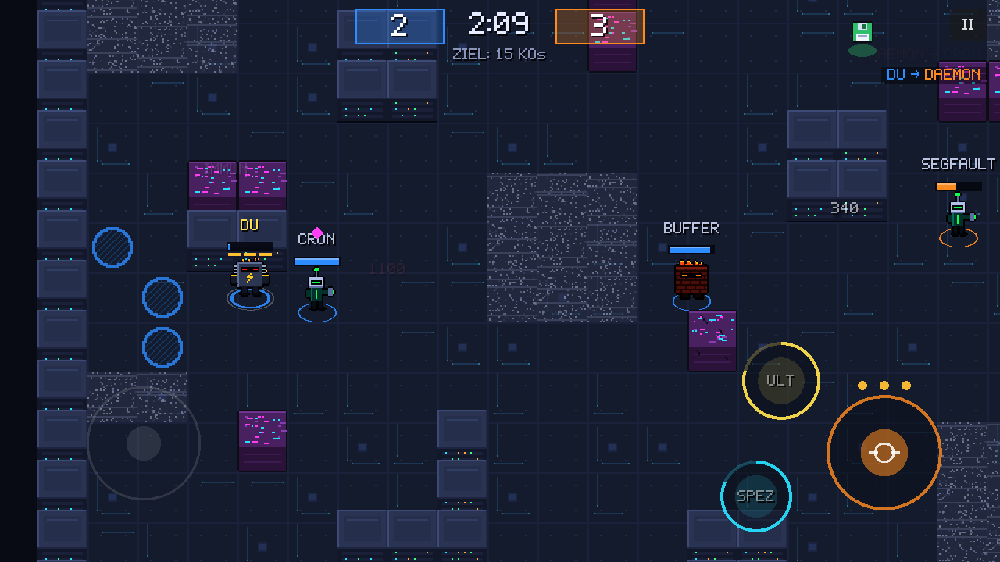

# Fortschrittsbericht 2: LAN-Mehrspieler

> **Stand:** 13.10.2026 · **Version:** 0.2.0 · **Engine:** Godot 4.7.2 · Vorheriger Stand: [Bericht 1](FORTSCHRITT.md)

## Kurzfassung

- **LAN-Mehrspieler funktioniert.** Ein Handy eröffnet das Spiel, die anderen finden es automatisch im WLAN (oder treten per IP bei). In der Lobby wählt jeder seinen Charakter. Freie Plätze füllen Bots. Nach dem Match geht es gemeinsam zurück in die Lobby.
- **Getestet mit zwei echten Spielinstanzen** über das Netzwerk, auch unter schlechten Bedingungen: Bei 100 ms Ping und 5 % Paketverlust läuft das Match stabil.
- **Verbesserungsvorschläge 2–4 aus Bericht 1 sind umgesetzt:** OVERCLOCK ist nicht mehr chancenlos, Breitbild-Ränder werden genutzt, und Namen überlappen sich nicht mehr.
- **APK 0.2.0** (28 MB) mit den zusätzlichen WLAN-Berechtigungen für die Spielsuche.
- **Weiterhin offen:** Test auf echten Handys im echten WLAN, Sound und Online-Modus.

---

## Neu: LAN-Mehrspieler

Im Hauptmenü ist „LAN-SPIEL“ jetzt freigeschaltet.

### So funktioniert es

| Schritt | Was passiert |
|---|---|
| Spiel eröffnen | Das Handy startet einen Server (UDP-Port 47800) und meldet sich jede Sekunde per Broadcast im WLAN (Port 47801). |
| Beitreten | Andere Handys sehen das Spiel in der Liste „Gefundene Spiele“, alternativ geht es über die angezeigte IP. Das funktioniert auch im Hotspot eines Handys. |
| Lobby | Der Host wählt den Modus (Team-Crash oder Duell). Teams werden abwechselnd gefüllt, jeder wählt seinen Charakter. |
| Match | Der Host simuliert alles. Jeder Client schickt nur seine Eingaben und bekommt 30-mal pro Sekunde den Zustand zurück. |
| Abbruch | Verliert ein Client die Verbindung, übernimmt ein Bot seinen Kämpfer. Verlässt der Host das Spiel, landen alle mit einem Hinweis wieder in der Spielsuche. |

**Technik (Konzept 11.3):**
- **Client-Vorhersage:** Die eigene Figur bewegt sich sofort, ohne auf den Host zu warten. Kommt ein Snapshot, wird die Position mit dem Host abgeglichen, und noch nicht bestätigte Eingaben werden erneut angewendet.
- **Interpolation:** Alle anderen Figuren werden mit 100 ms Verzögerung zwischen zwei Snapshots geglättet.
- **Verlustsicherheit:** Jedes Eingabe-Paket enthält die letzten drei Eingaben. Ein verlorenes Paket kostet deshalb keinen Angriff.
- **Anti-Wallhack:** Gegner im Rauschen-Feld schickt der Host einem Client gar nicht erst. Er erfährt ihre Position also nicht.
- **Eigene Sicht:** Jeder sieht sein Team in Blau. Siegerbanner und Ergebnis sind aus eigener Sicht formuliert.

### Bilder

| Host | Client |
|---|---|
|  |  |
| Lobby aus Sicht des Hosts: Er sieht seine IP und kann Modus und Start bestimmen. | Dieselbe Lobby beim Client: Er hat PING gewählt und wartet auf den Start. |
|  |  |
| Das Match auf dem Host (16:9). | Dasselbe Match auf dem Client, hier als 20:9-Breitbild mit Seitenleisten. Der Client spielt eigentlich Team Orange, sein Team erscheint für ihn aber blau. |
|  |  |
| Ergebnis beim Host: Niederlage 5:7. Bots sind als „Bot“ markiert. | Gleiches Match beim Client: Sieg 7:5. Nur der Host kann alle zurück in die Lobby holen. |

### Messwerte (zwei Spielinstanzen, automatischer Test)

| Messung | Ergebnis |
|---|---|
| Ablauf Lobby → Match → Ergebnis → Lobby | auf Host und Client vollständig |
| Spielsuche per WLAN-Broadcast | Host gefunden und beigetreten |
| Snapshots (30 s Match) | 1063 gesendet, 1059 beim Client angekommen |
| Datenmenge pro Client | **19,3 KB/s** (Konzeptziel: unter 20 KB/s) |
| Spürbare Positionskorrekturen (über 4 px), gute Verbindung | 7 in 30 s |
| Mit 100 ms Ping und 5 % Paketverlust (simuliert) | 996 Snapshots, 25 Korrekturen in 30 s, Match regulär beendet |
| Exportiertes APK-Spielpaket als Host gegen einen Client | funktioniert |

Dazu kommen automatische Tests im selben Prozess: Der Client bildet Lebenspunkte, KOs und Punktestand exakt wie der Host nach. Die vorhergesagte eigene Position weicht weniger als 16 px ab, und nach einem Verbindungsabbruch übernimmt ein Bot.

---

## Umgesetzte Verbesserungsvorschläge aus Bericht 1

### 2: OVERCLOCK stärken

Die Ursache war ein Umsetzungsfehler: Laut Konzept ist ein Angriff eine **Kombo aus 3 Schlägen à 420**. Umgesetzt war aber nur ein Schlag pro Angriff, also ein Drittel des Schadens. Das ist behoben. Außerdem gilt jetzt:
- OVERCLOCK: 5000 LP (vorher 4400), Dash-Abklingzeit 4,5 s (vorher 6 s), halber Schaden während des Dashs
- FIREWALL war danach zu stark: 4 × 340 statt 4 × 380 Schaden, Nachladen 1,7 s, Schild 2,5 s
- Bots schlagen nicht mehr in einen aktiven Frontschild, sondern umgehen ihn

**Balancing-Simulation (Bot gegen Bot, gleiche Stichprobe wie in Bericht 1):**

| Duell (je 20 Spiele) | Bericht 1 | Jetzt |
|---|---|---|
| OVERCLOCK vs PING | 1 : 19 | **16 : 4** |
| OVERCLOCK vs FIREWALL | 0 : 20 | **9 : 11** |
| PING vs FIREWALL | 3 : 17 | **9 : 11** |

| Team-Crash (24 Matches) | Ø Schaden vorher → jetzt | Ø KOs vorher → jetzt | Ø Tode vorher → jetzt |
|---|---|---|---|
| OVERCLOCK | 17 515 → 29 236 | 3,6 → 6,2 | 6,9 → 5,8 |
| PING | 32 395 → 31 654 | 5,6 → 4,3 | 3,0 → 3,1 |
| FIREWALL | 30 905 → 24 275 | 4,5 → 3,2 | 3,8 → 4,8 |

Daraus ergibt sich ein Schere-Stein-Papier-Muster: Der Nahkämpfer schlägt den Scharfschützen, die anderen Paarungen sind fast ausgeglichen. Ob OVERCLOCK gegen PING mit 16:4 zu stark ist, sollten Tests mit Menschen zeigen, denn Bots weichen schlechter aus als Spieler.

### 3: Breitbild-Ränder nutzen

Auf 20:9-Handys bleibt das sichtbare Spielfeld 640 × 360 groß, damit niemand einen Sichtvorteil hat. Die Ränder sind jetzt aber Seitenleisten: Angriffs-Stick und Pause-Taste wandern hinein und verdecken weniger Spielfeld. Die Notch bzw. Safe Area wird auf dem Handy berücksichtigt.

### 4: Mehr Übersicht im Gedränge

Namen erscheinen nur noch, wenn sie keinen anderen überdecken; nahe Kämpfer haben Vorrang. Hinweise wie „BLOCK“ stapeln sich, statt übereinander zu liegen, und Schadenszahlen für dasselbe Ziel werden zusammengefasst.

---

## Neue und offene Verbesserungsvorschläge

1. **Auf echten Handys im echten WLAN testen (dringend).** Alle Tests liefen auf einem Rechner. Ob der WLAN-Broadcast auf Android ankommt, hängt vom Gerät und vom Router ab. Manche Router blockieren Broadcasts zwischen Geräten (Gast- oder „AP-Isolation“-Modus). Dann hilft das Beitreten per IP oder der Hotspot eines Handys.
2. **Beitreten per QR-Code.** Das Konzept sieht einen QR-Code mit IP und Port vor. Das spart das Abtippen der IP, wenn die Suche nicht funktioniert.
3. **Wieder einsteigen nach Verbindungsabbruch.** Bisher übernimmt ein Bot dauerhaft. Das Konzept sieht 30 Sekunden zum Wiederverbinden vor.
4. **Teams in der Lobby selbst wählen.** Bisher teilt der Host abwechselnd ein.
5. **Datenmenge für den Online-Modus senken.** 19,3 KB/s sind für das WLAN kein Problem. Für Mobilfunk sollte der Snapshot aber nur Änderungen übertragen (Delta-Kompression).
6. **Große Kämpfe bleiben unübersichtlich.** Bei 4 und mehr Figuren auf engem Raum überlagern Schadenszahlen weiterhin die Namen.
7. **Weiterhin offen aus Bericht 1:** Sound, Randpfeile für Gegner außerhalb des Bildes, Angriffsanimationen, Tutorial.

## Selbst ausprobieren

- **Mit zwei Handys:** APK auf beiden installieren und beide ins selbe WLAN bringen (oder ein Handy öffnet einen Hotspot). Auf dem einen „LAN-SPIEL“ → „SPIEL ERÖFFNEN“ wählen. Auf dem anderen „LAN-SPIEL“ wählen und das Spiel in der Liste antippen.
- **Am Rechner:** `tools/net_test.sh 30` startet Host und Client automatisch. Mit `tools/net_test.sh 30 50,5` läuft derselbe Test mit 100 ms Ping und 5 % Paketverlust.
