# Fortschrittsbericht 1: Spielbarer Prototyp

> **Stand:** 13.10.2026 · **Version:** 0.1.0 · **Engine:** Godot 4.7.2 · **Konzept:** [KONZEPT.md](KONZEPT.md)

## Kurzfassung

- **Spielbar:** 3 Charaktere (OVERCLOCK, PING, FIREWALL), 3 Modi (Team-Crash 3v3, Duell 1v1, Training), 2 Arenen plus Trainingslabor. Mitspieler und Gegner sind Bots.
- **Steuerung:** Twin-Stick-Touch-Steuerung mit Auto-Aim beim Antippen und Zielvorschau beim Ziehen.
- **APK:** Ein signiertes Debug-APK wird automatisch gebaut (28 MB, nur arm64, minSdk 24, targetSdk 36).
- **Qualität:** 1094 automatische Prüfungen sind grün. Eine Balancing-Simulation liefert erste Messwerte.
- **Noch offen:** echter Mehrspieler (LAN/online), Sound, Progression. Außerdem wurde **noch nicht auf einem echten Handy getestet**.

Der Prototyp deckt **Phase 0** des Konzepts vollständig ab und von **Phase 1** alles außer dem LAN-Modus.

---

## Umsetzungsstand gegenüber dem Konzept

| Konzeptpunkt | Status | Anmerkung |
|---|---|---|
| Top-Down-Arena, Pixelart 640 × 360, Querformat | ✅ | Alle Grafiken werden per Skript erzeugt (`tools/gen_assets.py`) |
| Twin-Stick-Steuerung, Auto-Aim, Zielvorschau | ✅ | Desktop zusätzlich mit Maus und WASD |
| Kampfsystem: 3 Ladungen, Cooldowns, Ultimate, Regeneration, Respawn | ✅ | Werte aus Konzept Abschnitt 5 |
| Statuseffekte: Schild, Markierung, Unverwundbarkeit, Übertaktung, Tempo, Schaden | ✅ | *Lag* und *Freeze* kommen mit BLUESCREEN |
| Rauschen-Felder (Verstecken), zerstörbare Blöcke, Power-ups | ✅ | Gegner im Rauschen werden nicht angezeigt |
| Charaktere OVERCLOCK, PING, FIREWALL | ✅ | TROJAN, PATCH und BLUESCREEN folgen |
| Modi Team-Crash, Duell, Training | ✅ | „Upload“ und „Memory Leak“ folgen |
| Arenen Serverraum, Papierkorb | ✅ | Punktsymmetrisch, die Symmetrie wird automatisch geprüft |
| Bot-KI (Zielwahl, Abstand, Ausweichen, Wegfindung, Fähigkeiten, Rückzug) | ✅ | Drei Stärkestufen in den Einstellungen |
| Menüs: Hauptmenü, Charakterwahl, Ergebnis, Einstellungen, Pause | ✅ | |
| Vibration, Bildschirmwackeln, FPS-Anzeige | ✅ | |
| Android-APK, Signierung, CI-Pipeline | ✅ | Build-Skript und GitHub Actions; Release-APK bei Tags `v*` |
| LAN-Mehrspieler (Host/Beitreten/QR) | ⏳ | Nächster Schritt. Die Simulation ist darauf vorbereitet (Eingabe-Frames, feste Tick-Reihenfolge). |
| Online, Matchmaking, Progression, Sound, Tutorial | ⏳ | Phasen 2 und 3 |

---

## Bilder

### Hauptmenü
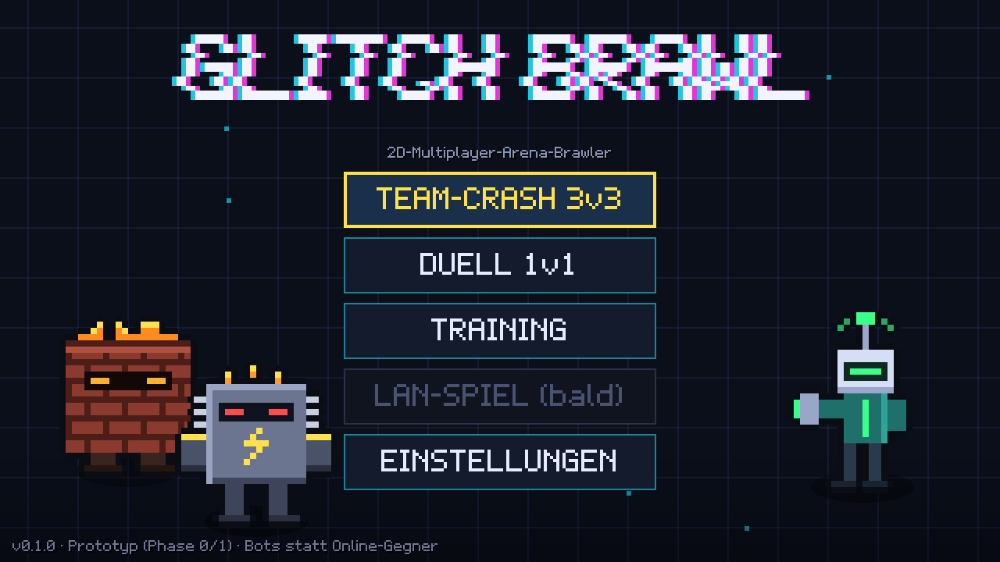
Logo mit RGB-Glitch, animierter Raster-Hintergrund, alle Charaktere animiert. „LAN-SPIEL“ ist noch ausgegraut.

### Charakterwahl
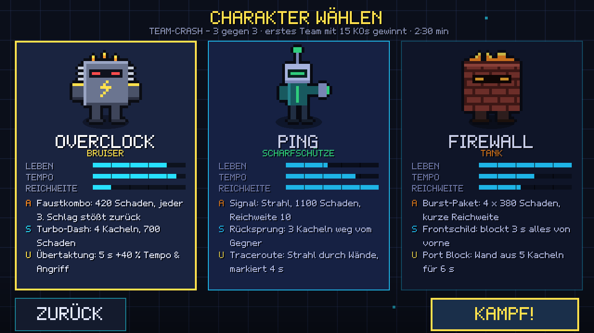
Jede Karte zeigt Rolle, Werte-Balken und die drei Fähigkeiten (**A**ngriff, **S**pezial, **U**ltimate). Die Texte stammen direkt aus den Spieldaten.

### Team-Crash: Zielen
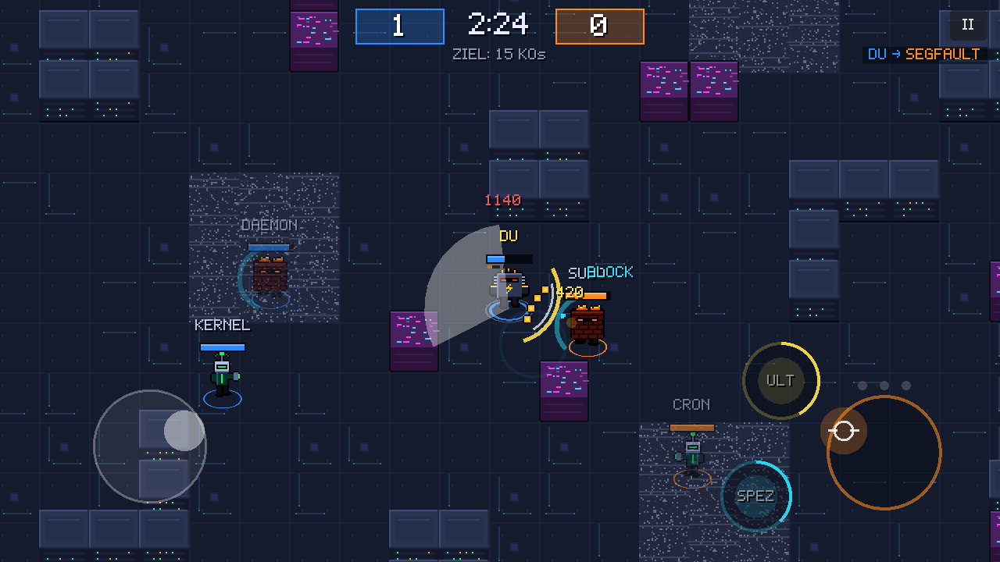
Links der dynamische Bewegungs-Stick, rechts der Angriffs-Stick. Beim Ziehen zeigt ein Kegel die Reichweite von OVERCLOCKs Faustkombo. Ebenfalls zu sehen: FIREWALLs Frontschild (cyan Bogen, „BLOCK“), Rauschen-Felder (graues Flimmern) und der Kill-Feed oben rechts.

### Team-Crash: Fähigkeiten
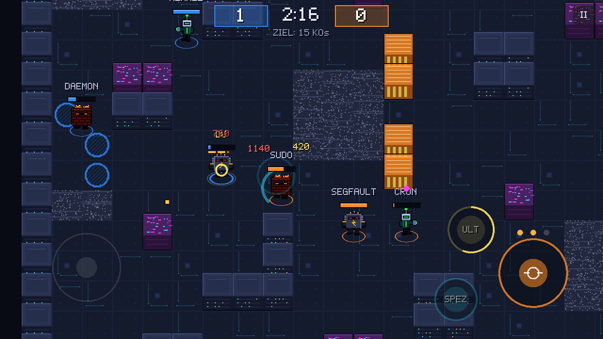
Die orangen Wände sind FIREWALLs Ultimate *Port Block*: Sie stehen 6 Sekunden und blockieren Wege und Schüsse. Die Lebensbalken sind nach Teams eingefärbt (eigenes Team blau, Gegner orange).

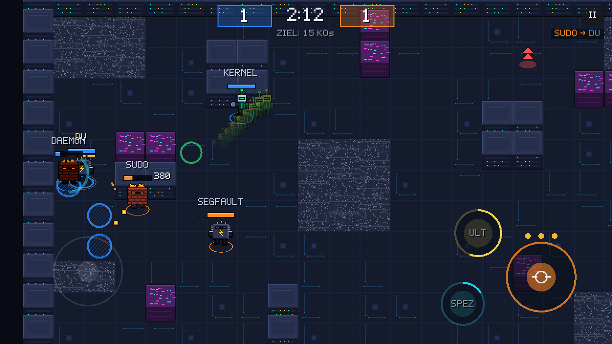
OVERCLOCKs *Turbo-Dash* mit Nachbild-Spur. Lila Datenblöcke sind zerstörbar. Ein Power-up (Diskette = *Backup*, heilt 1500 LP) wartet in der Arena.

### Match-Ende und Ergebnis
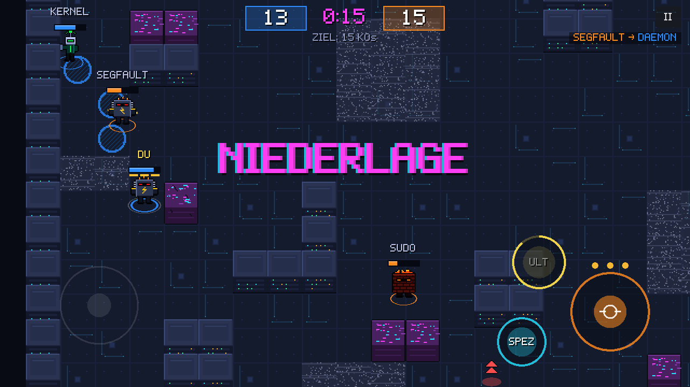
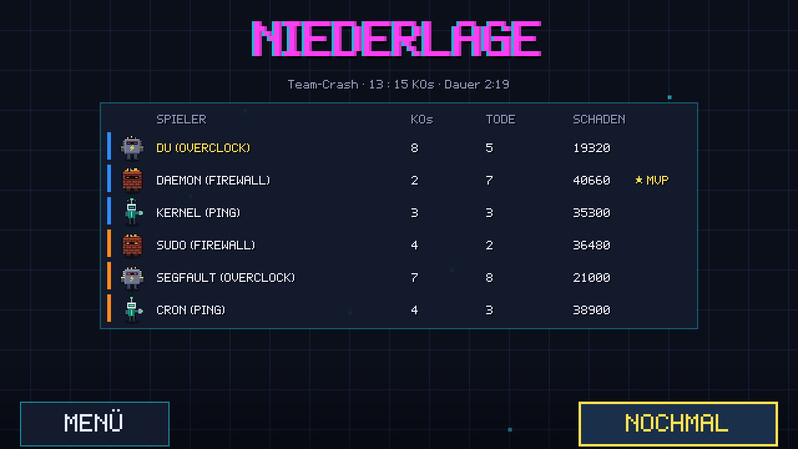
Dieses Match haben die Bots regulär zu Ende gespielt, das eigene Team verlor 13:15. Die Ergebnisliste zeigt KOs, Tode und Schaden pro Spieler sowie den MVP.

### Duell
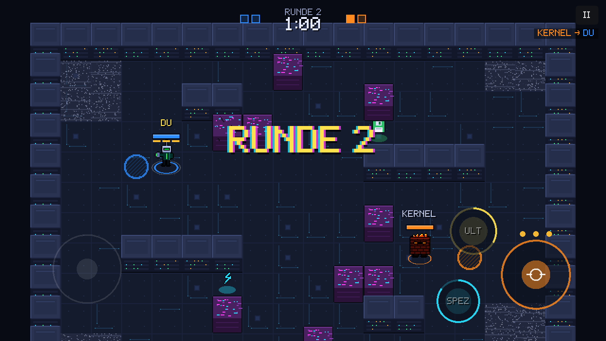
Best of 3 auf der kleinen Arena „Papierkorb“: Rundenanzeige oben, Rundenbanner und 60 Sekunden pro Runde.

### Training
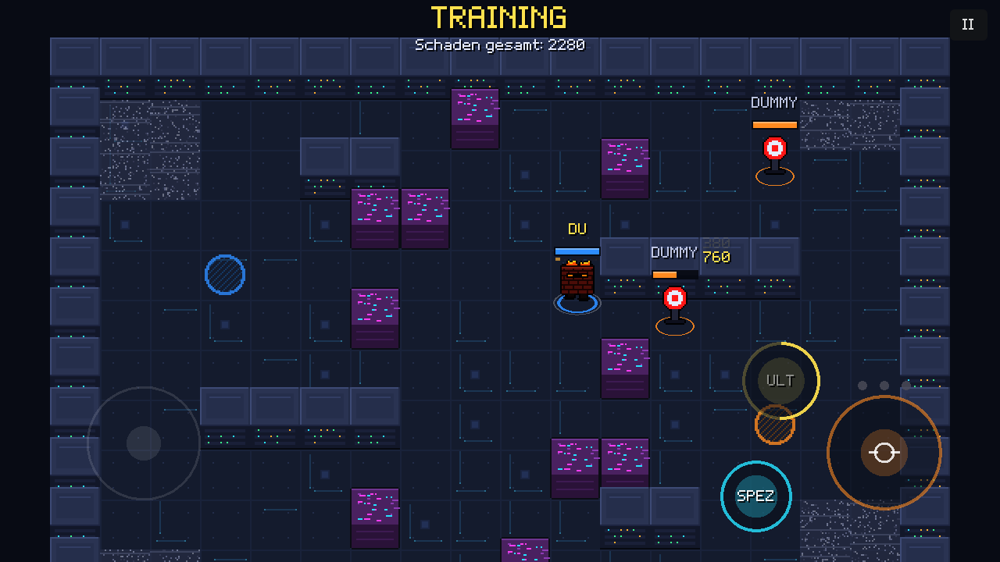
Trainings-Dummys mit Schadenszahlen und einem Gesamtschaden-Zähler. Der Modus endet nicht von selbst.

### Einstellungen
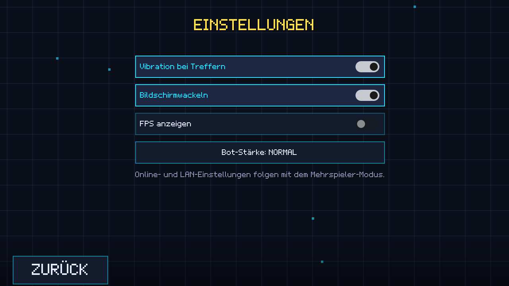

### Breitbild-Handy (20:9)
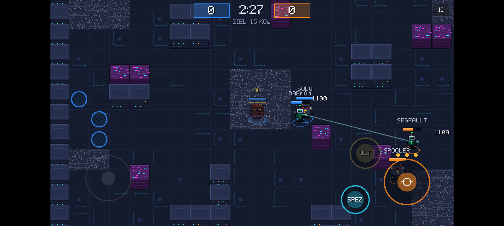
Auf modernen 20:9-Handys entstehen links und rechts schwarze Ränder. Das ist gewollt, damit niemand mehr vom Spielfeld sieht. Die Ränder werden aber noch nicht genutzt (siehe Vorschlag 3).

---

## Tests und Messwerte

### Automatische Tests
`godot --headless --path game res://tests/test_runner.tscn` → **1094 Prüfungen, 0 Fehler**

Geprüft werden:
- Karten: Zeilenlängen, Punktsymmetrie, geschlossener Rand, gleich viele Spawns, Erreichbarkeit
- Kollision und Sichtlinien
- Schaden und Munition
- Schild blockt von vorne, aber nicht von hinten
- Unsichtbarkeit im Rauschen
- Port-Block-Wände entstehen und verschwinden wieder
- Komplette Bot-Matches (Team-Crash, Duell) laufen bis zum Ende
- Training

### Balancing-Simulation (Bot gegen Bot, Stärke „normal“)
`godot --headless --path game res://tests/balance_sim.tscn -- --duels=20 --teams=24`

| Duell (20 Spiele je Paarung) | Siege | Ø Dauer |
|---|---|---|
| OVERCLOCK vs PING | **1 : 19** | 17 s |
| OVERCLOCK vs FIREWALL | **0 : 20** | 15 s |
| PING vs FIREWALL | 3 : 17 | 24 s |

| Team-Crash (24 Matches) | Ø Schaden | Ø KOs | Ø Tode |
|---|---|---|---|
| OVERCLOCK | 17 515 | 3,6 | **6,9** |
| PING | 32 395 | 5,6 | 3,0 |
| FIREWALL | 30 905 | 4,5 | 3,8 |

Ø Matchdauer Team-Crash: 111 s (Konzept: 2:30 min maximal). Bots spielen allerdings anders als Menschen, deshalb sind diese Werte nur ein erster Hinweis.

---

## Ausbesserungsvorschläge (nach Priorität)

1. **Auf echten Handys testen (dringend).** Bisher lief alles nur auf dem Desktop bzw. in der Cloud-Umgebung. Das APK ist gebaut und geprüft, aber noch nie auf einem Gerät gestartet worden. Zu prüfen sind Bildrate, Akku, das Gefühl der Touch-Steuerung und die Vibration auf einem Einsteiger- und einem Mittelklasse-Gerät.
2. **OVERCLOCK stärken.** Die Simulation zeigt ihn klar zu schwach (Duelle 1:19 und 0:20, im Team etwa doppelt so viele Tode). Ein Teil liegt an der Bot-KI, die als Nahkämpfer frontal anläuft. Vorschlag: LP 4400 → 5000, Dash-Cooldown 6 s → 4,5 s, kurzer Schadensschutz während des Dashs. Außerdem sollen Bots über Deckung und Rauschen-Felder anschleichen.
3. **Breitbild-Ränder nutzen.** Auf 20:9-Handys bleiben die seitlichen Ränder schwarz. Die Touch-Buttons sollten in die Ränder wandern, damit sie das Spielfeld nicht mehr verdecken. Gleichzeitig muss die Notch bzw. Safe Area berücksichtigt werden.
4. **Mehr Übersicht im Gedränge.** Bei 4 und mehr Figuren überlappen sich Namen, Lebensbalken und Hinweise wie „BLOCK“. Vorschlag: Gegnernamen kleiner oder nur bei Nähe anzeigen, Hinweise versetzt stapeln.
5. **Treffer besser lesbar machen.** PINGs Strahl wird auf Brusthöhe gezeichnet, der Treffer aber auf Fußhöhe berechnet. Ein knapper Fehlschuss sieht so aus, als ginge der Strahl durch den Gegner hindurch. Vorschlag: eine Trefferzone vom Fuß bis zur Brust (Kapsel) statt eines Kreises.
6. **Sound fehlt komplett.** Jede Fähigkeit braucht einen eigenen kurzen Chiptune-Effekt (Konzept 3.3), dazu Musik für Menü und Match.
7. **Gegner außerhalb des Bildes.** Die im Konzept vorgesehenen Randpfeile fehlen noch. Gerade für PING-Spieler sind sie wichtig.
8. **Animationen.** Bisher gibt es nur Stehen und Laufen, und die Figuren schauen nur nach links oder rechts. Eigene Angriffs- und Treffer-Frames würden die Kämpfe deutlich lesbarer machen.
9. **Kurzes Tutorial.** Neue Spieler bekommen noch keine Erklärung zu Antippen vs. Ziehen und zu Spezial und Ultimate.

## Nächste Schritte (Vorschlag)

1. APK auf 2–3 Handys installieren und Feedback sammeln (Vorschläge 1–4)
2. **LAN-Mehrspieler** (Konzept 11.4): Host/Beitreten, UDP-Discovery, QR-Code; Bots füllen leere Plätze
3. Sound und Balancing-Runde 2

---

## Selbst bauen und testen

```bash
# Grafiken neu erzeugen (optional, die Ergebnisse liegen im Repo)
python3 tools/gen_assets.py

# Tests
godot --headless --path game res://tests/test_runner.tscn

# Debug-APK (benötigt Godot 4.7.2 + Export-Vorlagen, Android-SDK mit apksigner, JDK 17+)
ANDROID_SDK_ROOT=/pfad/zum/sdk tools/build_apk.sh debug

# Screenshots wie in diesem Bericht (Linux mit Xvfb)
tools/screenshots.sh build/screenshots
```

**APK auf dem Handy installieren:** APK aufs Handy kopieren → in den Einstellungen „Installation aus unbekannten Quellen“ für den Dateimanager erlauben → APK öffnen → installieren.
