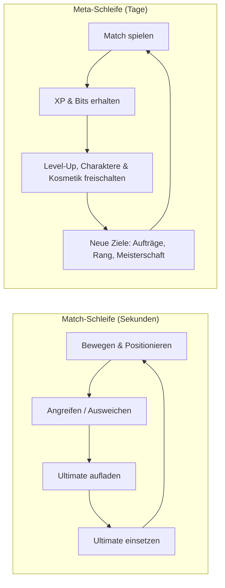
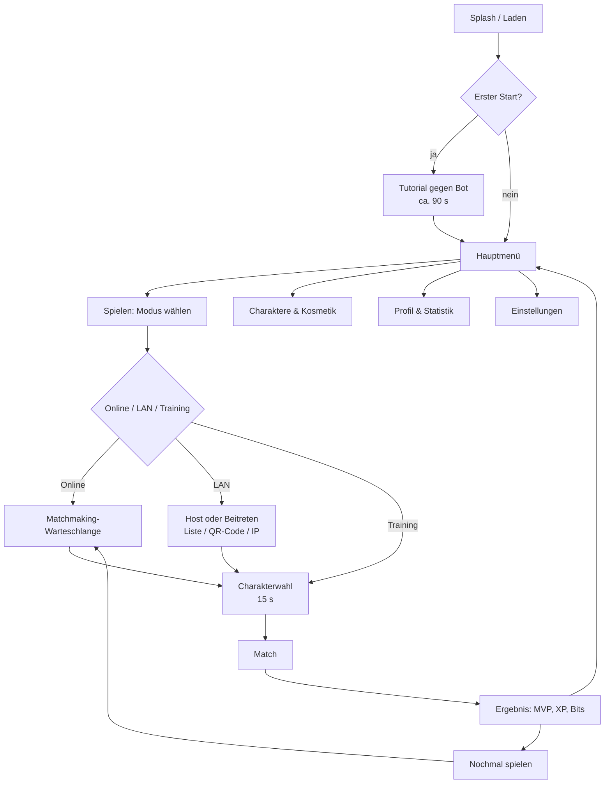
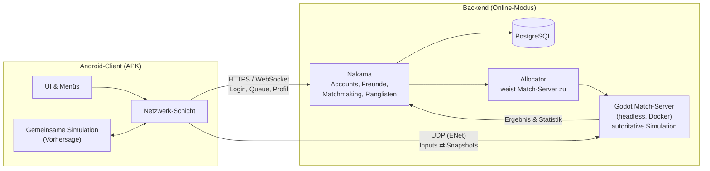
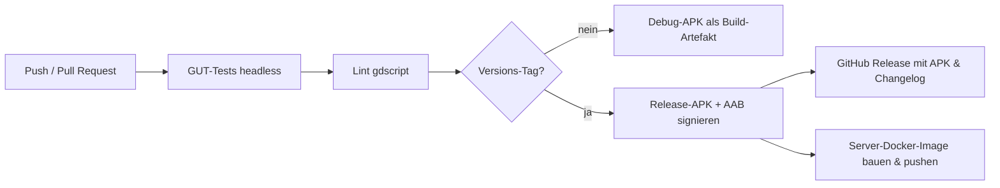

# GLITCH BRAWL – Spielkonzept

> **Arbeitstitel:** GLITCH BRAWL
> **Genre:** 2D-Multiplayer-Arena-Brawler (Top-Down, Twin-Stick)
> **Plattform:** Android (APK, später zusätzlich AAB für Google Play)
> **Dokumentversion:** 0.1 · Stand: 13.10.2026

---

## Inhalt

1. [Elevator Pitch](#1-elevator-pitch)
2. [Eckdaten](#2-eckdaten)
3. [Setting & Stil](#3-setting--stil)
4. [Kern-Gameplay](#4-kern-gameplay)
5. [Charaktere (Start-Roster)](#5-charaktere-start-roster)
6. [Spielmodi](#6-spielmodi)
7. [Arenen](#7-arenen)
8. [Progression & Monetarisierung](#8-progression--monetarisierung)
9. [Soziales & Community](#9-soziales--community)
10. [UI & Screens](#10-ui--screens)
11. [Technik](#11-technik)
12. [APK: Build & Verteilung](#12-apk-build--verteilung)
13. [Qualitätssicherung](#13-qualitätssicherung)
14. [Roadmap](#14-roadmap)
15. [Risiken](#15-risiken)
16. [Offene Fragen](#16-offene-fragen)

---

## 1. Elevator Pitch

Das System ist abgestürzt. In den Trümmern des Speichers kämpfen abtrünnige
Programme – **Firewall, Trojan, Ping, Patch, Bluescreen, Overclock** – um die
letzten freien Ressourcen.

**GLITCH BRAWL** ist ein schneller 2D-Arena-Brawler fürs Handy: Matches dauern
**2–3 Minuten**, gesteuert wird mit **zwei virtuellen Sticks**, gespielt wird
**1 gegen 1, 3 gegen 3 oder jeder gegen jeden** – im **WLAN mit Freunden**
(ein Handy ist Host, kein Server nötig) oder **online**.

**Leitprinzipien**

| Prinzip | Bedeutung |
|---|---|
| **Skill statt Grind** | Keine kaufbaren oder erspielbaren Stat-Boni. Jeder Charakter ist in jedem Match gleich stark. |
| **Sofort spielbar** | Vom App-Start ins Match in unter 30 Sekunden. |
| **Lesbarkeit** | Jede Fähigkeit hat eine eindeutige Silhouette, Farbe und einen eigenen Sound. |
| **Kurz & intensiv** | Ein Match passt in eine Bus-Station oder eine Pause. |
| **Fair verteilt** | Alle spielrelevanten Inhalte sind kostenlos erspielbar. |

---

## 2. Eckdaten

| Punkt | Festlegung |
|---|---|
| Perspektive | Top-Down (Vogelperspektive), 2D-Pixelart |
| Ausrichtung | Querformat (Landscape) |
| Spielerzahl | 2 (Duell) · 6 (3v3) · 6 (Jeder gegen jeden) |
| Matchdauer | 1–3 Minuten |
| Zielgruppe | 12+, Casual bis Mid-Core, Fans von Brawl Stars / Smash-artigen Party-Spielen |
| Engine | Godot 4 (aktuelle stabile 4.x-Version, Stand Oktober 2026: 4.6) |
| Auslieferung | APK (Sideload, GitHub Releases), später AAB (Google Play) |
| Mindest-Android | Android 7.0 (API 24) |
| Sprachen | Deutsch und Englisch ab dem ersten Release |
| Online-Pflicht | Nein: Training und LAN funktionieren offline |

---

## 3. Setting & Stil

### 3.1 Welt

Das Spiel findet **im Inneren eines abgestürzten Computers** statt. Arenen sind
digitale Orte (Serverraum, Motherboard, Papierkorb, Cloud), Charaktere sind
personifizierte Programme und Systemfehler. Das Thema liefert Namen, Effekte und
Humor („Fatal Exception!“, „404 – Gegner nicht gefunden“) und passt zum
Projektnamen *SystemError*.

### 3.2 Grafik

- **Pixelart**, interne Auflösung **640 × 360**, ganzzahlig skaliert (×2, ×3, ×4) → scharfe Pixel auf allen Displays.
- Kachelgröße **32 × 32 px**, Charaktere ca. **32 × 40 px**.
- **Farbpalette:** dunkle Hintergründe (Dunkelblau/Anthrazit) mit Neon-Akzenten (Cyan, Magenta, Gelb).
- **Teamfarben:** Blau vs. Orange (auch bei Rot-Grün-Schwäche unterscheidbar).
- **Glitch-Effekte** als Shader: chromatische Aberration bei Treffern, Scanlines im Menü, kurzes „Zerreißen“ des Sprites bei einem KO.
- Für den Prototyp reichen freie Asset-Packs (z. B. CC0-Pakete von Kenney). Eigene Grafiken folgen ab Phase 1.

### 3.3 Audio

- Chiptune- bzw. Synthwave-Soundtrack (Menü, Match, letzte 30 Sekunden mit höherem Tempo).
- Jede Fähigkeit hat einen eigenen, sofort wiedererkennbaren Sound.
- 2D-Positionsaudio: Gegner außerhalb des Bildschirms sind hörbar.

---

## 4. Kern-Gameplay

### 4.1 Gameplay-Schleifen



### 4.2 Steuerung (Touch)

| Element | Position | Verhalten |
|---|---|---|
| **Bewegungs-Stick** | linke Bildschirmhälfte | Dynamisch: erscheint dort, wo der Daumen aufsetzt. |
| **Angriffs-Stick** | rechts unten | **Tippen:** Auto-Aim auf das nächste Ziel in Reichweite. **Ziehen:** manuelles Zielen mit Vorschau (Reichweite und Trefferlinie). **Loslassen:** Feuern. **Zurück zur Mitte:** Abbrechen. |
| **Spezial-Button** | über dem Angriffs-Stick | Wie der Angriffs-Stick (zielbar oder per Tippen automatisch); zeigt den Cooldown als Kreis. |
| **Ultimate-Button** | neben dem Spezial-Button | Leuchtet und pulsiert bei 100 %, ist zielbar. |
| **Emote-Button** | oben rechts | Öffnet ein Rad mit 4 Emotes oder Quick-Chat-Sätzen. |

**Weitere Optionen**

- **Layout-Editor:** Position, Größe und Transparenz jedes Buttons anpassbar, Linkshänder-Spiegelung.
- **Haptik:** kurze Vibration bei Treffer und erlittenem Schaden (abschaltbar).
- **Controller:** Bluetooth-Gamepads werden unterstützt (Godot-Input-Mapping).
- **Faire Sichtweite:** Der sichtbare Spielbereich ist für alle Spieler gleich groß. Breitere Displays (z. B. 20:9) bekommen seitliche Ränder bzw. HUD-Fläche statt mehr Sicht.

### 4.3 Kampfsystem

| Mechanik | Regel (Startwerte für das Balancing) |
|---|---|
| **Lebenspunkte (LP)** | 2 600 – 5 200 je nach Charakter |
| **Angriffs-Ladungen** | 3 Ladungen. Jede lädt nach (Standard 1,5 s pro Ladung). Kein Dauerfeuer. |
| **Spezialfähigkeit** | Fester Cooldown (6–10 s) |
| **Ultimate** | Lädt sich durch verursachten Schaden (Patch auch durch Heilung). Bleibt nach einem KO erhalten. |
| **Regeneration** | 3 s ohne Schaden und ohne eigenen Angriff → 12 % der max. LP pro Sekunde |
| **Respawn** | 3 s in Teammodi; im Duell und in „Memory Leak“ keiner |
| **Hitboxen** | Kreise für Charaktere, Kreise/Linien/Kegel für Angriffe |
| **Projektile** | Werden von Wänden blockiert, außer eine Fähigkeit sagt etwas anderes |
| **Rauschen-Felder** | Wie „Büsche“: Wer darin steht, ist für Gegner unsichtbar, außer diese sind näher als 2 Kacheln oder man greift an |

### 4.4 Statuseffekte

| Effekt | Thema | Wirkung |
|---|---|---|
| **Lag** | Verlangsamung | −35 % Bewegungstempo |
| **Freeze** | Betäubung | Keine Bewegung und keine Aktionen |
| **Korruption** | Schaden über Zeit | X Schaden pro Sekunde, keine Regeneration |
| **Schild** | Schutz | Absorbiert Schaden bis zu einem festen Wert |
| **Tarnung** | Unsichtbarkeit | Für Gegner unsichtbar, endet beim Angriff |
| **Markiert** | Aufdeckung | Für das gegnerische Team sichtbar, auch im Rauschen |

### 4.5 Power-ups in der Arena

Power-ups erscheinen alle 30 s an festen, symmetrischen Punkten.

| Power-up | Wirkung |
|---|---|
| **Backup** | Heilt sofort 1 500 LP |
| **Cache** | +30 % Tempo für 6 s |
| **Overflow** | +25 % Schaden für 8 s |

---

## 5. Charaktere (Start-Roster)

Sechs Charaktere decken die klassischen Rollen ab. Die Werte sind **Startwerte
für das Balancing** und werden nach Playtests angepasst.
1 Kachel = 32 px.

| Charakter | Rolle | LP | Tempo (Kacheln/s) | Basisangriff | Spezial | Ultimate |
|---|---|---|---|---|---|---|
| **FIREWALL** | Tank | 5 200 | 2,6 | **Burst-Paket:** Schrotladung mit 4 Projektilen × 380 Schaden, Reichweite 4 | **Frontschild:** blockt 3 s alle Projektile von vorne (CD 8 s) | **Port Block:** errichtet für 6 s eine Wand aus 5 Kacheln |
| **TROJAN** | Assassine | 3 200 | 3,2 | **Doppelklinge:** Nahkampf 2 × 600, Reichweite 1,5 | **Tarnung:** 2,5 s unsichtbar (CD 10 s) | **Backdoor:** Teleport hinter ein Ziel in 6 Kacheln Reichweite, 1 500 Schaden |
| **PING** | Scharfschütze | 2 600 | 2,8 | **Signal:** Strahl mit 1 100 Schaden, Reichweite 10 | **Rücksprung:** Dash 3 Kacheln nach hinten (CD 7 s) | **Traceroute:** Strahl durch Wände, 1 400 Schaden, markiert getroffene Gegner 4 s |
| **PATCH** | Support | 3 400 | 2,8 | **Update-Orb:** heilt Verbündete um 500 bzw. trifft Gegner mit 450, Reichweite 7 | **Heilzone:** 4 s lang 300 LP/s für Verbündete (CD 10 s) | **Hotfix:** Team im Radius 5 wird 2 s unverwundbar und heilt 30 % |
| **BLUESCREEN** | Kontrolle | 3 800 | 2,7 | **Fehlerkugel:** langsames Projektil mit 800 Schaden plus *Lag* (1,5 s) | **Freeze-Mine:** löst bei Kontakt 1 s *Freeze* aus (CD 9 s) | **Fatal Exception:** nach 0,75 s Vorwarnung 1,5 s *Freeze* im Radius 3 |
| **OVERCLOCK** | Bruiser | 4 400 | 3,0 | **Faustkombo:** 3 Schläge × 420, der dritte stößt zurück | **Turbo-Dash:** 4 Kacheln, 700 Schaden (CD 6 s) | **Übertaktung:** 5 s lang +40 % Tempo und Angriffsgeschwindigkeit, danach 2 s *Lag* |

**Design-Regeln für weitere Charaktere**

- Jeder Charakter hat **genau eine** klare Stärke und eine ausnutzbare Schwäche.
- Jede Fähigkeit muss in **≤ 0,3 s** visuell erkennbar sein (Animation und Farbe).
- Kontrolleffekte (*Freeze*) haben immer eine sichtbare Vorwarnung oder einen kurzen Cooldown.
- Ein neuer Charakter kommt erst dazu, wenn der vorige in den Statistiken stabil ist (Siegquote zwischen 45 und 55 %).

**Ausbau-Ideen:** SPAM (beschwört Mini-Bots), DEFRAG (ordnet die Arena um,
verschiebt Wände), KERNEL (Konter gegen Statuseffekte), CAPTCHA (Fallen,
verwirrt die Steuerung).

---

## 6. Spielmodi

| Modus | Spieler | Ziel | Dauer |
|---|---|---|---|
| **Duell** | 1 vs 1 | Best of 3 Runden. Nach 45 s schrumpft die Zone („Speicherleck“). | ca. 2–3 min |
| **Team-Crash** | 3 vs 3 | Team-Deathmatch: Zuerst 15 KOs oder die meisten KOs nach 2:30 min | 2:30 min |
| **Upload** | 3 vs 3 | In der Mitte erscheinen Datenpakete. Man trägt bis zu 5 Pakete zum eigenen Upload-Terminal (jedes Paket kostet 4 % Tempo). Bei einem KO fallen alle getragenen Pakete. Gewonnen hat, wer zuerst 20 Pakete hochlädt oder nach 3:00 min mehr hat. | max. 3 min |
| **Memory Leak** | 6, jeder gegen jeden | Last Man Standing. Zerstörbare „Archive“ geben Upgrades für das laufende Match (+LP, +Schaden). Ab 0:45 schrumpft die Leak-Zone mit steigendem Schaden. | ca. 3 min |
| **Training** | 1 + Bots | Offline gegen Bots, Bot-Stärke wählbar, Trainingsdummy mit Schadensanzeige | frei |
| **Privater Raum** | 2–6 | Jeder Modus mit Freunden über Raum-Code bzw. QR-Code, online oder im LAN | frei |

**Bots** nutzen eine einfache Utility-KI (Ziel wählen, Abstand halten,
ausweichen, Power-ups einsammeln) und dienen für Training, Tutorial und als
Lückenfüller, wenn das Matchmaking zu lange dauert oder ein Spieler die
Verbindung verliert.

**Ranglistenmodus** (ab Phase 3): Team-Crash und Upload mit MMR-System
(Glicko-2) und Ligen: *Bronze → Silber → Gold → Platin → Diamant → Root*.

---

## 7. Arenen

| Arena | Modus | Größe (Kacheln) | Besonderheit |
|---|---|---|---|
| **Papierkorb** | Duell | 18 × 12 | Klein, viele zerstörbare Datenmüll-Blöcke |
| **Serverraum** | Team-Crash | 30 × 18 | Server-Racks als Deckung, 3 Lanes, Rauschen-Felder an den Flanken |
| **Motherboard** | Upload | 30 × 20 | Leiterbahnen als Speed-Lanes (+25 % Tempo), Terminal pro Team |
| **Cloud** | Memory Leak | 40 × 40 | Groß und offen, Abgründe an den Rändern (Rückstoß hinein = KO) |

**Regeln für das Arena-Design**

- Teammodi sind **punktsymmetrisch**, damit keine Seite bevorzugt ist.
- Deckung etwa alle 4–6 Kacheln, damit Fernkämpfer nicht dominieren.
- Spawnpunkte sind geschützt (kurze Unverwundbarkeit von 1,5 s nach dem Respawn).
- Zerstörbare Blöcke bleiben für den Rest des Matches zerstört. So verändert sich die Arena im Laufe des Matches.
- Arenen werden als **Godot-TileMap** gebaut und sind datengetrieben, sodass später ein Arena-Editor möglich ist.

---

## 8. Progression & Monetarisierung

### 8.1 Progression (ohne Pay-to-Win)

| System | Funktion |
|---|---|
| **Account-Level** | XP aus jedem Match. Level-Ups schalten Charaktere frei (fester Pfad: Start mit 3, weitere auf Level 3, 6 und 10). |
| **Bits** (Soft-Währung) | Für Matches, Siege und Aufträge. Damit kauft man Kosmetik. |
| **Tägliche Aufträge** | z. B. „Gewinne 2 Matches mit einem Fernkämpfer“ |
| **Charakter-Meisterschaft** | Spielzeit pro Charakter schaltet Kosmetik frei (Titel, Rahmen, Skin-Varianten) |
| **Saisons** (ab Phase 4) | Etwa 8 Wochen, kostenloser Saison-Pfad mit Kosmetik |

**Wichtig:** Charaktere haben **keine Level und keine Stat-Upgrades**. Ein
Neueinsteiger mit freigeschaltetem PING ist genauso stark wie ein Veteran.

### 8.2 Monetarisierung (Empfehlung)

| Phase | Modell |
|---|---|
| **APK / Beta** | Komplett kostenlos, keine Werbung, kein Shop. Optional ein Spendenlink (außerhalb von Google Play erlaubt). |
| **Google Play (1.0)** | Nur Kosmetik: Skins, Emotes, Spuren und ein optionaler Saison-Pass über **Google Play Billing** (für digitale Güter in Play-Apps Pflicht). |
| **Nicht vorgesehen** | Lootboxen (rechtliche Risiken und Einfluss auf die Altersfreigabe), Werbung im Match, kaufbare Spielvorteile |

---

## 9. Soziales & Community

- **Freundescode** und Freundesliste mit Online-Status.
- **Private Räume** über einen 6-stelligen Code oder QR-Code.
- **Kein freier Text-Chat** im Spiel, nur **Quick-Chat und Emotes**. Das spart Moderationsaufwand und schützt jüngere Spieler.
- **Replays** der letzten 10 Matches auf Basis der aufgezeichneten Server-Snapshots (Ausbaustufe).
- **Spieler melden** (AFK, Bot-Verdacht, anstößiger Name).

---

## 10. UI & Screens

### 10.1 Screen-Fluss



### 10.2 HUD im Match (Querformat)

```
┌──────────────────────────────────────────────────────────────────┐
│ BLAU ■■■■□  4 : 3  □■■■■ ORANGE      1:42      Ping 48 ms    [≡] │
│                                                       [Emote]    │
│                                                                  │
│                  ─── Spielfeld (Kamera folgt) ───                │
│                                                                  │
│                                                                  │
│                                                   [SPEZIAL]      │
│      ( o )                                               (ULT)   │
│    Bewegen                                          ( o )        │
│  (dynamisch)                                       Angriff       │
└──────────────────────────────────────────────────────────────────┘
```

- Eigene LP-Leiste und Ladungen direkt unter der eigenen Figur, nicht am Bildschirmrand.
- Gegner außerhalb des Bildschirms: Randpfeile in Teamfarbe.
- Kill-Feed als kleine Icons oben in der Mitte.
- **Safe-Area** (Notch, abgerundete Ecken) wird berücksichtigt (`DisplayServer.get_display_safe_area()`).

### 10.3 Barrierefreiheit

- Farbenblind-Modi (Teamfarben und Effektfarben umschaltbar).
- Skalierbare Schriftgröße, Option für weniger Bildschirmwackeln und Blitzeffekte.
- Untertitel für Voice-Lines, falls es welche gibt.

---

## 11. Technik

### 11.1 Engine-Entscheidung: Godot 4

| Kriterium | Godot 4 | Unity | Flutter + Flame |
|---|---|---|---|
| Kosten / Lizenz | Kostenlos, MIT-Lizenz, keine Umsatzbeteiligung | Kostenlos bis zu einer Umsatzgrenze, danach kostenpflichtiges Abo | Kostenlos |
| 2D-Qualität | Sehr gut (eigene 2D-Pipeline, Pixel-Snap) | Gut | Ausreichend |
| Android-Export (APK/AAB) | Eingebaut | Eingebaut | Eingebaut |
| Multiplayer | ENet/UDP, RPCs, Headless-Server-Export eingebaut | Über Zusatzpakete | Selbst bauen |
| Dedizierter Server aus derselben Codebasis | Ja (Export „Dedicated Server“, `--headless`) | Ja | Nein |
| APK-Größe | Klein | Mittel bis groß | Klein |

**Entscheidung: Godot 4** mit **GDScript**: kostenlos, sehr guter 2D-Support
und **Client und Server teilen sich denselben Spiellogik-Code**.

- **Renderer:** *Compatibility* (OpenGL ES 3.0) für maximale Geräteabdeckung.
- **Stretch-Modus:** `viewport` mit 640 × 360 und ganzzahliger Skalierung.

### 11.2 Architektur



**Drei Betriebsarten, eine Codebasis**

| Betriebsart | Wer simuliert? | Backend nötig? |
|---|---|---|
| **Training** | Lokal auf dem Handy | Nein |
| **LAN** | Host-Handy (Listen-Server: Server und Spieler in einem Prozess) | Nein |
| **Online** | Dedizierter Godot-Server in einem Rechenzentrum | Ja |

### 11.3 Netcode

Der Server ist **autoritativ**: Er allein entscheidet über Treffer, Schaden und
KOs. Clients schicken nur Eingaben.

| Thema | Lösung |
|---|---|
| **Tickrate** | Server simuliert mit 30 Hz und sendet Snapshots mit 20–30 Hz. Client rendert mit 60 FPS. |
| **Transport** | ENet (UDP). *Unreliable* für Inputs und Snapshots, *reliable* für Ereignisse (KO, Emote, Matchende). |
| **Inputs** | Pro Tick: Bewegungsvektor, Zielvektor, Aktions-Bits und Sequenznummer. Jedes Paket enthält die letzten 3 Inputs, damit Paketverlust kaum auffällt. |
| **Client-Vorhersage** | Die eigene Figur bewegt sich sofort. Bei jedem Snapshot wird abgeglichen; Abweichungen werden weich korrigiert (Reconciliation). |
| **Interpolation** | Fremde Figuren werden mit ca. 100 ms Puffer zwischen zwei Snapshots interpoliert. |
| **Lag-Kompensation** | Der Server spult Positionen für Treffer-Prüfungen bis zu 200 ms zurück (wichtig für PINGs Strahl). |
| **Projektile** | Der Client zeigt sofort ein lokales Projektil; der Server ist maßgeblich und korrigiert bei Bedarf. |
| **Bandbreite** | Delta-Kompression gegen den zuletzt bestätigten Snapshot, quantisierte Positionen (16 bit). Ziel: unter 20 KB/s pro Client, also unter 4 MB pro 3-Minuten-Match. |
| **Anti-Wallhack** | Der Server sendet keine Positionen von Gegnern, die im Rauschen oder getarnt sind (Interest Management). |
| **Verbindungsabbruch** | Wiederverbinden innerhalb von 30 s möglich. In der Zwischenzeit übernimmt ein Bot. |
| **Versionierung** | Protokollversion beim Verbindungsaufbau. Bei Abweichung erscheint ein Update-Hinweis. |

**Gemeinsame Simulation:** Bewegung, Kollision, Fähigkeiten und Schaden liegen
in einem Ordner `shared/`, der **auf Client und Server identisch** läuft. Die
Charakterwerte sind Daten (Godot-Ressourcen bzw. JSON). Der Server schickt sie
beim Matchstart mit. **Balance-Änderungen sind damit ohne neues APK möglich.**

**Hinweis:** Godots `MultiplayerSynchronizer` wird nur für Lobby und Menüs
genutzt. Für das Match wird ein eigenes Input/Snapshot-System gebaut, weil
Vorhersage und Lag-Kompensation volle Kontrolle brauchen.

### 11.4 LAN-Modus

- **Host:** Ein Handy startet den Server im eigenen Prozess und spielt selbst mit.
- **Finden:** UDP-Broadcast im lokalen Netz (z. B. Port 47800, einmal pro Sekunde) → Liste offener Spiele.
- **Fallback:** Beitreten per **QR-Code** (enthält IP und Port) oder manuelle IP-Eingabe.
- **Ohne Router:** Funktioniert auch, wenn ein Handy einen **mobilen Hotspot** öffnet und die anderen sich verbinden.
- **Android-Hinweis:** Für das Empfangen von Broadcasts braucht es auf manchen Geräten die Berechtigung `CHANGE_WIFI_MULTICAST_STATE`.

### 11.5 Backend (ab Phase 2)

| Baustein | Technologie | Aufgabe |
|---|---|---|
| **Nakama** (Open Source, Apache 2.0) | Docker | Geräte-Login (anonym per Geräte-ID, optional Google-Konto), Freunde, Matchmaker, Ranglisten, Speicher für Profile |
| **Datenbank** | PostgreSQL | Profile, Inventar, Match-Historie |
| **Allocator** | Kleiner eigener Dienst (später Agones auf Kubernetes) | Startet bzw. vergibt Match-Server-Instanzen, gibt dem Client IP, Port und Join-Token |
| **Match-Server** | Godot-Headless-Export in Docker | Autoritative Simulation, mehrere Matches pro Prozess |
| **Hosting** | Zunächst ein VPS in Frankfurt (EU) | Später weitere Regionen nach Bedarf |

**Datenschutz (DSGVO):** Nur nötige Daten speichern (Geräte-ID, Spielername,
Statistik), Datenschutzerklärung in der App, Konto-Löschung in den
Einstellungen. Telemetrie wird anonymisiert und ist abschaltbar.

### 11.6 Geplante Projektstruktur

```
/
├── game/                      # Godot-Projekt (Client + gemeinsamer Code)
│   ├── project.godot
│   ├── shared/                # Simulation: Bewegung, Kollision, Schaden, Regeln
│   ├── characters/
│   │   └── firewall/          # Szene, Skript, Sprites, Werte (.tres)
│   ├── abilities/             # Wiederverwendbare Fähigkeits-Bausteine
│   ├── maps/                  # TileMaps der Arenen
│   ├── modes/                 # Regeln pro Spielmodus
│   ├── net/                   # Input-Puffer, Snapshots, Vorhersage, LAN-Discovery
│   ├── bots/                  # Bot-KI
│   ├── ui/                    # Menüs, HUD, Touch-Steuerung
│   ├── audio/
│   └── tests/                 # GUT-Unit-Tests
├── server/
│   ├── Dockerfile             # Headless Match-Server
│   ├── nakama/                # Nakama-Module (TypeScript)
│   └── docker-compose.yml
├── docs/
│   └── KONZEPT.md             # dieses Dokument
└── .github/workflows/         # CI: Tests, APK-Build, Releases
```

### 11.7 Performance-Ziele

| Ziel | Wert |
|---|---|
| Bildrate | Stabil 60 FPS auf Mittelklasse-Geräten (ca. 4 GB RAM, ab 2020), Option für 30 FPS |
| Akku | Höchstens ca. 8 % Verbrauch pro 15 Minuten Spielzeit (Mittelklasse) |
| APK-Größe | Unter 80 MB (nur arm64-v8a) |
| Startzeit | Unter 5 s bis zum Hauptmenü |
| Spielbare Latenz | Gut bis 120 ms, spielbar bis 200 ms |

---

## 12. APK: Build & Verteilung

### 12.1 Build-Konfiguration

| Einstellung | Wert |
|---|---|
| Paketname | z. B. `io.github.systemerror5251.glitchbrawl` (endgültig festlegen, später nicht mehr änderbar) |
| `minSdk` | 24 (Android 7.0) |
| `targetSdk` | 36 (Android 16). Ist seit 31.08.2026 Pflicht für neue Apps und Updates auf Google Play. |
| Architekturen | `arm64-v8a` (optional ein zusätzliches APK für `armeabi-v7a`) |
| Build-Art | Godot „Gradle Build“ (nötig für AAB, eigene Plugins und das Setzen des targetSdk) |
| Formate | **APK** für Sideload und GitHub Releases, **AAB** für Google Play |
| Ausrichtung | Querformat (`sensor_landscape`) |

### 12.2 Signierung

- **Debug-Keystore** für Tests, **Release-Keystore** für Veröffentlichungen.
- Den Release-Keystore **sicher sichern** (Passwort-Manager und Offline-Kopie). Geht er verloren, kann ein per APK verteiltes Spiel nicht mehr aktualisiert werden.
- In der CI wird der Keystore als verschlüsseltes Secret übergeben (Godot liest dafür die Umgebungsvariablen `GODOT_ANDROID_KEYSTORE_RELEASE_PATH`, `…_USER`, `…_PASSWORD`).
- Für Google Play: **Play App Signing** aktivieren, der eigene Schlüssel wird dann Upload-Schlüssel.

### 12.3 CI-Pipeline (GitHub Actions)



Kern des Builds:

```bash
godot --headless --export-release "Android" build/glitch-brawl.apk
```

### 12.4 Verteilung

| Kanal | Wann | Hinweise |
|---|---|---|
| **GitHub Releases** | Ab Phase 1 | APK direkt herunterladen. Die App prüft beim Start über die GitHub-API, ob es eine neue Version gibt, und zeigt einen Download-Link. |
| **Google Play** | Ab Phase 3 | AAB. Neue *private* Entwicklerkonten brauchen vor dem Livegang einen geschlossenen Test (aktuell 12 Tester über 14 Tage). Alterseinstufung über den IARC-Fragebogen. |
| **Alternative Stores** (z. B. F-Droid) | Optional | F-Droid nur bei vollständig quelloffenem Code und ohne proprietäre Dienste |

**Wichtig – Entwickler-Verifizierung durch Google:** Google führt schrittweise
eine Pflicht ein, dass auch **außerhalb des Play Stores verteilte APKs** auf
zertifizierten Android-Geräten einem verifizierten Entwickler zugeordnet sein
müssen. Die Pflicht gilt seit September 2026 zunächst in Brasilien, Indonesien,
Singapur und Thailand und soll **ab 2027 weltweit** folgen. Nicht verifizierte
APKs lassen sich dann nur noch über einen bewusst aufwendigen „erweiterten“
Installationsweg installieren.
**→ Konsequenz:** Rechtzeitig vor dem öffentlichen Release in der Android
Developer Console als Entwickler verifizieren und Paketnamen sowie
Signaturschlüssel registrieren. Den aktuellen Stand vor dem Release erneut
prüfen.

**Für Tester (Sideload-Anleitung, wird in der README ergänzt):**
APK herunterladen → „Installation aus unbekannten Quellen“ für den Browser bzw.
Dateimanager erlauben → APK öffnen → installieren.

### 12.5 Berechtigungen

| Berechtigung | Zweck |
|---|---|
| `INTERNET` | Online-Modus und LAN |
| `ACCESS_NETWORK_STATE` | Verbindungsstatus anzeigen |
| `ACCESS_WIFI_STATE`, `CHANGE_WIFI_MULTICAST_STATE` | LAN-Spiele finden (Broadcast) |
| `VIBRATE` | Haptisches Feedback |
| `CAMERA` (optional, nur bei Bedarf angefragt) | QR-Code zum Beitreten scannen |

Keine Standort-, Kontakt- oder Speicherberechtigungen.

---

## 13. Qualitätssicherung

| Bereich | Vorgehen |
|---|---|
| **Spiellogik** | Unit-Tests mit **GUT** (Godot Unit Test) für Schaden, Cooldowns, Statuseffekte und Modusregeln |
| **Netcode** | Tests mit künstlicher Latenz, Jitter und Paketverlust (Linux `tc netem`): 100 ms / 5 % Verlust muss gut spielbar sein |
| **Last** | Headless-Bot-Clients spielen viele Matches parallel gegen den Server |
| **Geräte** | Testmatrix: Einsteiger-, Mittelklasse- und Oberklasse-Gerät, verschiedene Seitenverhältnisse (16:9 bis 21:9) |
| **Balancing** | Telemetrie: Pick-Rate, Siegquote pro Charakter und Modus, Matchdauer, Abbruchquote |
| **Playtests** | Ab Phase 0 wöchentlich mit einer festen Testgruppe, kurzer Fragebogen nach jeder Session |

---

## 14. Roadmap

Die Zeitangaben sind **grobe Richtwerte für ein Team aus 1–2 Personen** und
werden nach dem Prototyp neu geschätzt.

| Phase | Inhalt | Fertig, wenn … | Richtwert |
|---|---|---|---|
| **0 – Prototyp** | 1 Charakter (OVERCLOCK), 1 Arena, Touch-Steuerung, einfacher Bot, Debug-APK aufs Handy | Sich das Bewegen und Kämpfen auf dem Handy gut anfühlt (Playtest-Urteil) | 3–4 Wochen |
| **1 – LAN-MVP** | 3 Charaktere (OVERCLOCK, PING, FIREWALL), 2 Arenen, Duell und Team-Crash, LAN mit Host/Beitreten/QR, Hauptmenü, APK über GitHub Releases | 6 Leute spielen ohne Abbrüche einen Abend lang im WLAN | + 6–8 Wochen |
| **2 – Online-Beta** | Dedizierter Server, Nakama, Matchmaking, alle 6 Charaktere, 4 Arenen, alle Modi, Bots als Lückenfüller, Telemetrie, Wiederverbinden | 50+ Beta-Tester spielen eine Woche stabil online | + 2–3 Monate |
| **3 – Release 1.0** | Progression, Kosmetik, Ranglistenmodus, Tutorial, DE/EN, Datenschutz, Google-Play-Release (AAB) mit geschlossenem Test, Entwickler-Verifizierung | Play-Store-Freigabe und öffentliches APK | + 2 Monate |
| **4 – Live-Betrieb** | Saisons, neue Charaktere (z. B. alle 6–8 Wochen), Events, Replays, weitere Server-Regionen | laufend | – |

---

## 15. Risiken

| Risiko | Auswirkung | Gegenmaßnahme |
|---|---|---|
| Mobilfunknetze mit Jitter und Paketverlust | Ruckeln, unfaire Treffer | Redundante Inputs, Interpolationspuffer, Lag-Kompensation, frühe `netem`-Tests |
| Touch-Steuerung zu ungenau | Frust | Auto-Aim per Tippen, Zielvorschau, große Hitboxen, Layout-Editor |
| Zu wenige Spieler online | Lange Wartezeiten | LAN und private Räume als Kern, Bots füllen auf, Matchmaking-Regeln lockern sich nach 20 s |
| Cheating | Unfairness | Server-autoritativ, Plausibilitätsprüfung der Inputs, kein Senden versteckter Positionen |
| Serverkosten | Laufende Kosten | Mehrere Matches pro Prozess, kleiner VPS zum Start, LAN braucht keinen Server |
| Hürden beim Sideloading (Entwickler-Verifizierung) | Weniger Installationen | Frühzeitig verifizieren, parallel Google Play anbieten |
| Zu großer Umfang | Projekt wird nie fertig | Strikte Phasen, Phase 0 erst abschließen, wenn das Kampfgefühl stimmt |
| Ähnlichkeit zu bekannten Spielen | Wenig Eigenständigkeit | Eigenes Setting (Glitch/Computer), eigene Modi (Upload, Memory Leak), Fokus auf LAN-Party-Spiel |

---

## 16. Offene Fragen

Diese Punkte sollten vor bzw. während Phase 0 entschieden werden:

1. **Zielgruppe:** Eher Casual-Party-Spiel im Freundeskreis (LAN zuerst) oder kompetitives Online-Spiel (Ranked zuerst)?
2. **Google Play:** Soll das Spiel mittelfristig in den Play Store oder dauerhaft nur als APK verteilt werden?
3. **Budget:** Wie viel darf der Server-Betrieb pro Monat kosten?
4. **Grafik:** Eigene Pixelart oder (zunächst) Asset-Packs bzw. Auftragsarbeit?
5. **Team:** Solo-Projekt oder Team? Davon hängt die Roadmap stark ab.
6. **Name:** Bleibt es bei „GLITCH BRAWL“? Vor dem Release Namens- und Markenrecherche durchführen.
